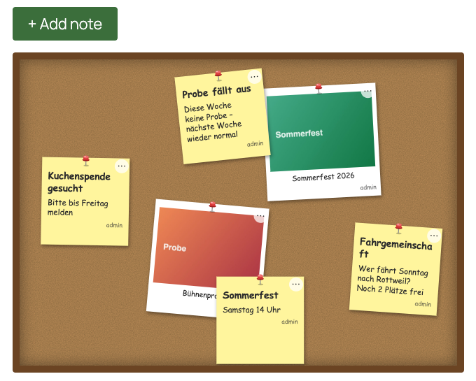
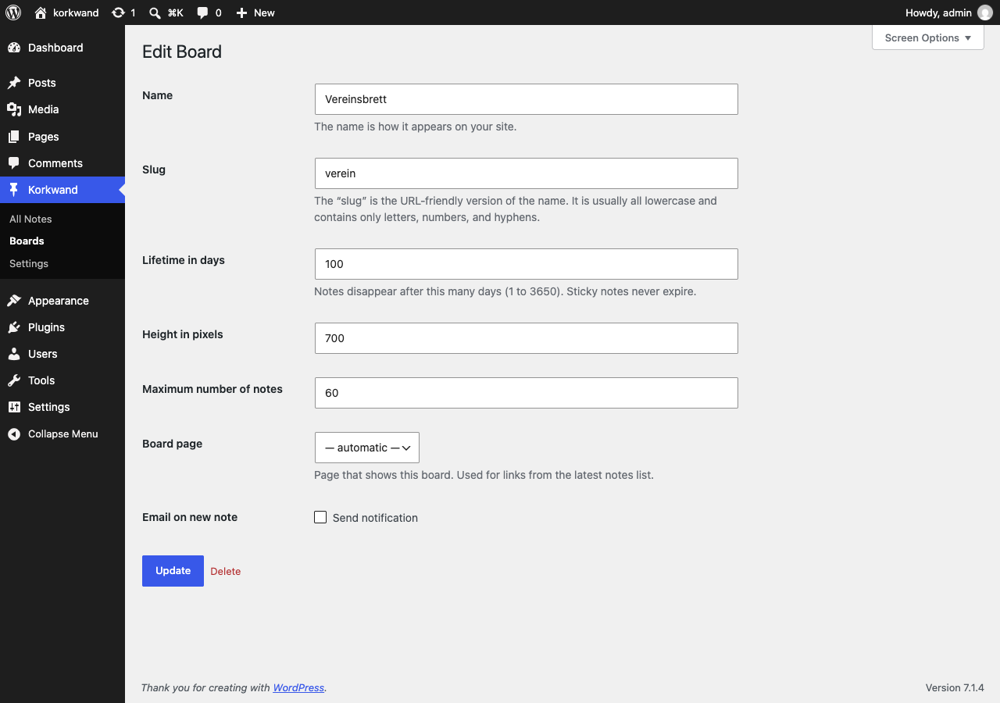
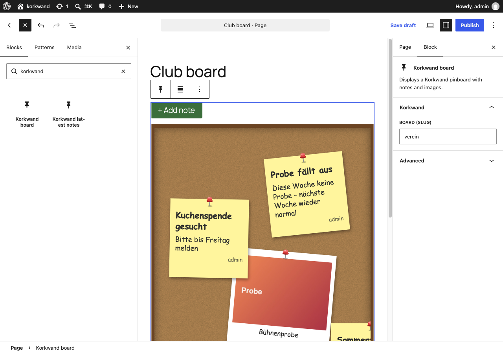
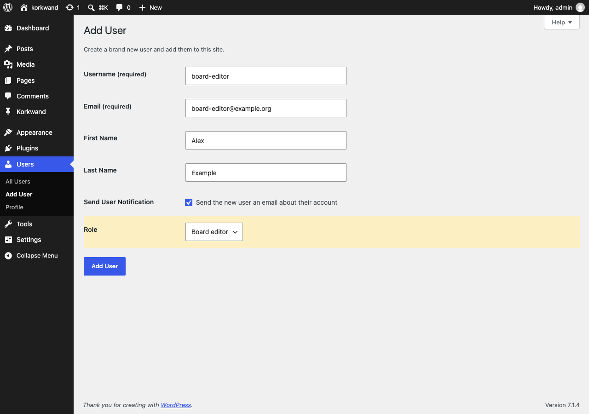
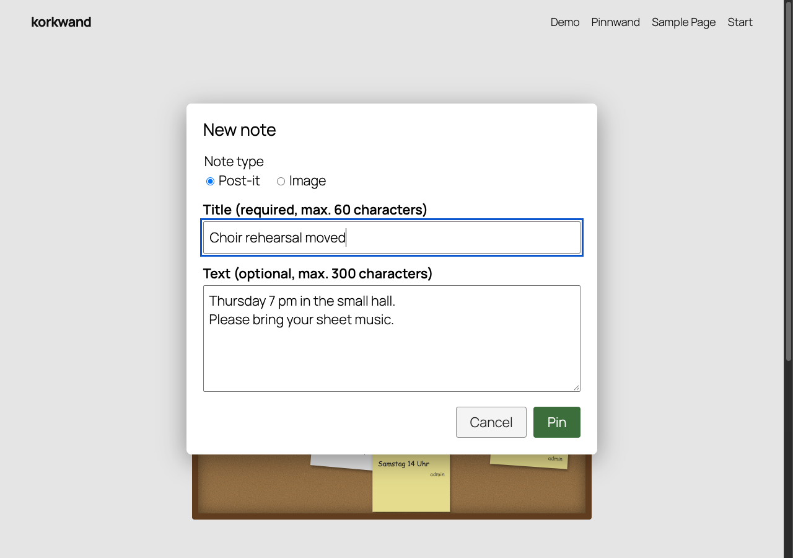
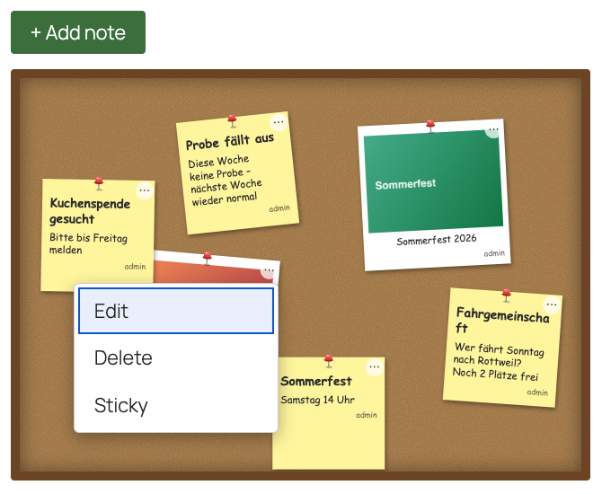
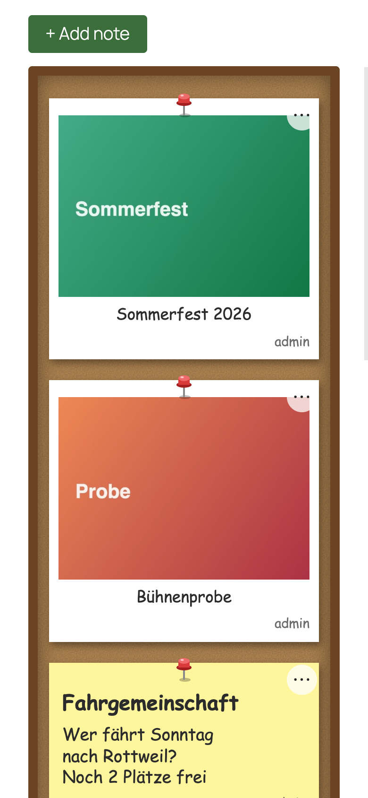
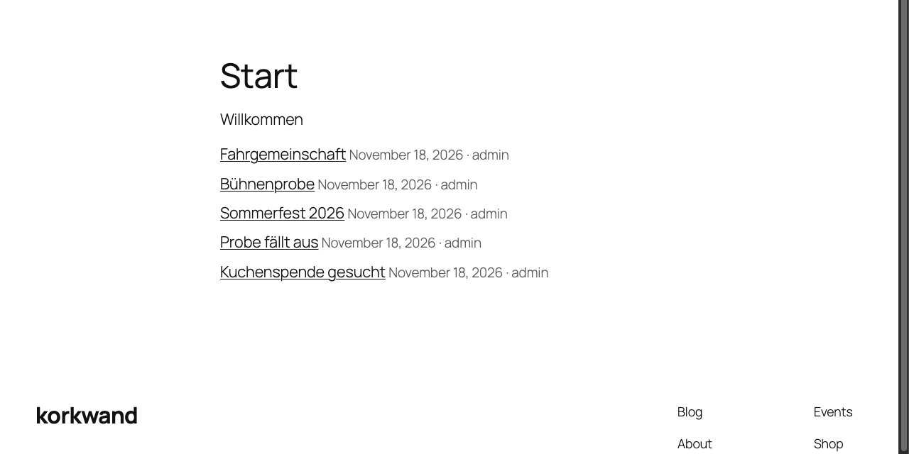

# Korkwand

**A cork pinboard for your WordPress site.** Board editors pin post-it notes and photos, everyone else just looks.

Use it as a notice board for a club or community, a team wall, a classroom or family pinboard, or a
"looking for / offering" board for your neighbourhood.



Requires WordPress 6.5 or newer and PHP 8.1 or newer. Free software under the GPL 2.0 or later.

**[Download the latest version](https://github.com/werthdavid/korkwand/releases/latest)**

---

## What you get

- **Post-it notes and photo notes** that can be placed anywhere on the board.
- **As many boards as you like**, each with its own lifetime, height and note limit.
- **A "latest notes" list** for your home page or sidebar, so visitors see what is new without opening the board.
- **Works on phones:** on small screens the board turns into a simple list.
- **Notes clean up after themselves:** each board has a lifetime, and expired notes disappear automatically.
- **Privacy-friendly:** guests never see who wrote a note, photo location data is removed on upload,
  and there are no external services, tracking or cookies.
- **In English and German.**

## Installation

1. Download `korkwand-<version>.zip` from the [releases page](https://github.com/werthdavid/korkwand/releases/latest).
2. In WordPress, go to *Plugins > Add New Plugin > Upload Plugin*, choose the ZIP file and click *Install Now*.
3. Click *Activate*.

A new menu **Korkwand** appears in the admin.

## Getting started

### 1. Create a board

Go to *Korkwand > Boards*, enter a name (for example "Club board") and a short slug (for example `club`), and click
*Add New Board*. Open the board to change its settings:



| Setting | What it does |
|---|---|
| **Lifetime in days** | Notes disappear after this many days (1 to 3650, default 100). Sticky notes stay. |
| **Height in pixels** | Height of the cork board on the page. |
| **Maximum number of notes** | The board shows at most this many notes: sticky notes first, then the newest. Older notes beyond the limit are no longer shown. |
| **Board page** | The page that shows this board. The "latest notes" list links there. Leave it on *automatic* and Korkwand finds the page itself. |
| **Email on new note** | Sends an email to the site administrator address whenever someone pins a note. |

### 2. Put the board on a page

Create or edit a page, click **+** and search for **Korkwand**. Insert the block **Korkwand board** and enter the
slug of your board in the block settings on the right.



If you use the classic editor, put this shortcode on the page instead:

```
[korkwand board="club"]
```

### 3. Decide who may post

| Who | Can do |
|---|---|
| Everyone, including visitors who are not logged in | Look at the board and the latest notes |
| **Board editor** (a role added by Korkwand) | Pin notes, edit and remove their own notes |
| Editor, Administrator | Additionally edit and remove any note, and mark notes as *sticky* |
| Administrator | Create boards and change their settings |

To let someone post, go to *Users*, edit the user (or add a new one) and set the **Role** to **Board editor**.
This role has no other rights: in the admin it only sees its own profile. Subscribers, Contributors and Authors cannot post.



## Using the board

Logged-in board editors see the button **+ Add note** above the board.

- **Post-it:** a title (up to 60 characters) and an optional text (up to 300 characters).
- **Image:** a JPEG, PNG or WebP photo (up to 8 MB, or less if your web host sets a lower limit) with an optional caption.



New notes appear on the board straight away. **Drag** a note to move it. The **…** button on a note opens a menu to
**edit** or **delete** it; editors and administrators can also make a note **sticky** so that it never expires.



On phones the board is shown as a list: sticky notes first, then the newest.



## Showing the newest notes on your home page

The **Korkwand latest notes** block shows a short list of the newest notes, for example on the home page or in a
sidebar. Each entry links to the board and highlights the note there.



- **On a page:** insert the block **Korkwand latest notes** and choose the board (or *All boards*), the number of notes
  (1 to 20) and whether to show the date.
- **In a sidebar (widget area):** go to *Appearance > Widgets*, open the sidebar, click **+** and add the block
  **Korkwand latest notes**. With a block theme, go to *Appearance > Editor* and add the block to the template or
  template part that holds your sidebar.
- **With a shortcode**, for example in a text or shortcode widget:

  ```
  [korkwand_latest board="club" count="5" show_date="1"]
  ```

  Leave out `board` to show notes from all boards.

The links only work if Korkwand knows the board page (see *Board page* above). Otherwise the list shows the notes
without links.

## Moderating

Editors and administrators can edit, delete and mark notes as sticky directly on the board. All notes are also listed
in the admin under *Korkwand > All Notes*. Turn on *Email on new note* in the board settings to be told about every new
note.

## Privacy

- Visitors who are not logged in never see the names of note authors, and author pages of users without published
  posts return "not found".
- Uploaded photos are re-saved without their metadata (such as camera and GPS location) and get random file names.
- Notes expire after the board's lifetime. Expired notes are hidden at once, moved to the trash by a daily job and
  deleted for good, together with their photos, when WordPress empties the trash (after 30 days by default).
- Korkwand supports the WordPress privacy tools (*Tools > Export Personal Data* and *Erase Personal Data*) and suggests
  a paragraph for your privacy policy (*Settings > Privacy*).

## Frequently asked questions

**Can visitors post without an account?**
No. Only logged-in users with the Board editor, Editor or Administrator role can post.

**How long do notes stay on the board?**
As long as the board's *Lifetime in days* (default 100). Sticky notes stay until someone removes them.

**Does it work with caching plugins?**
Yes. New notes show up for other visitors once the cache is refreshed. Most cache plugins skip the cache for
logged-in users, so board editors always see the current state.

**Can I change the look?**
Yes, with custom CSS. The colours and sizes are CSS custom properties starting with `--korkwand-`.

**What happens when I delete the plugin?**
By default, all boards, notes and uploaded photos are removed. To keep them, untick *Remove all notes and images when
the plugin is deleted* under *Korkwand > Settings* before you delete the plugin.

**Does it work on multisite?**
Yes. Each site has its own boards, notes and settings.

## Help and feedback

Found a bug or have an idea? Please open an issue on [GitHub](https://github.com/werthdavid/korkwand/issues).
Developers find setup, tests and the release process in [CONTRIBUTING.md](CONTRIBUTING.md).
